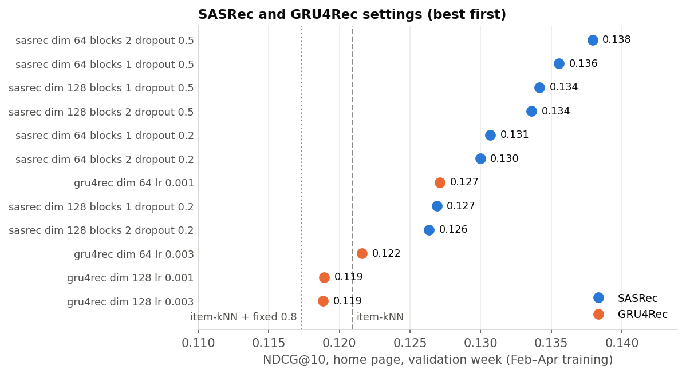
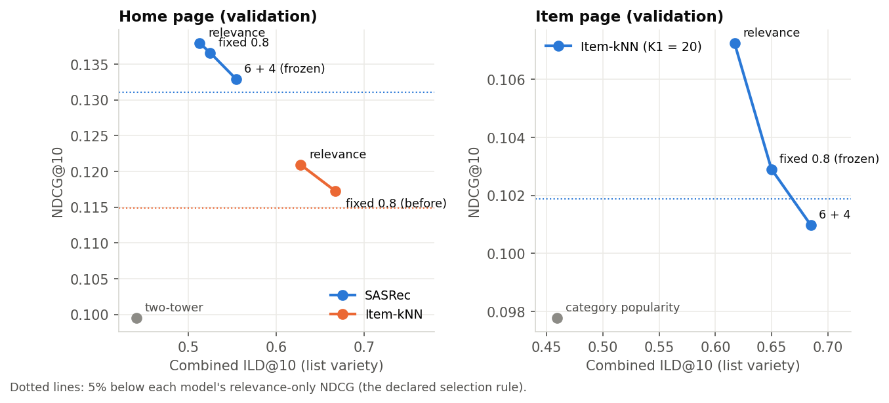
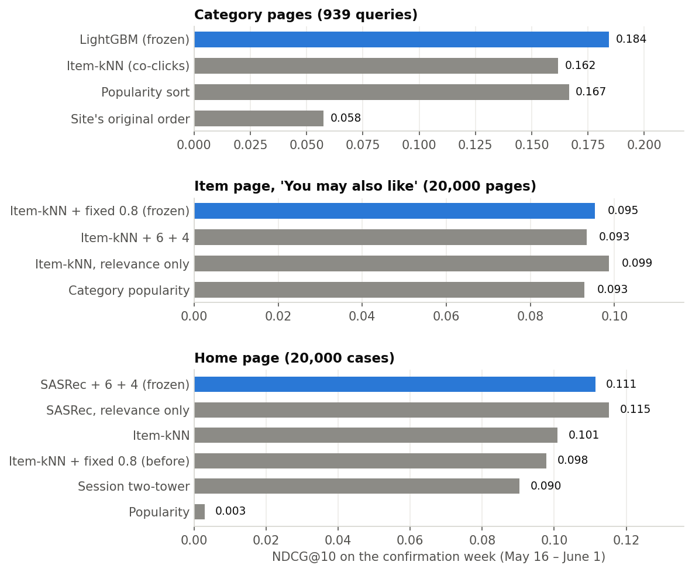
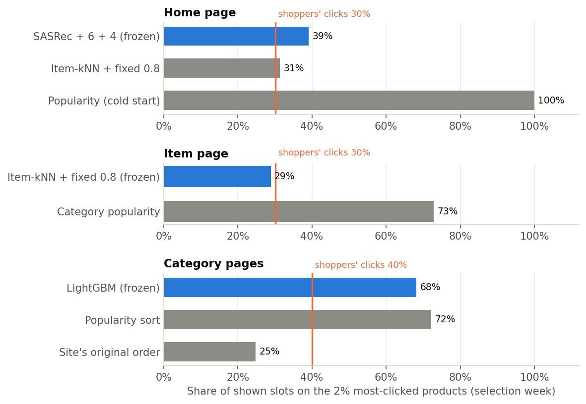

# Session-Aware Recommendations for an Anonymous Online Shop

**CP4285 project report, group g02.** Dataset: Diginetica (CIKM Cup 2016, Track 2).
Code, configurations and the full experiment record are in this repository
(`EXPERIMENT_LOG.md`); the ethical analysis is expanded in `ETHICS.md`; the
models packaged for the demo website are described in `HANDOFF.md`.

---

## Abstract

Most visitors of an online shop are anonymous and leave after a short visit, so
a recommender has only the current session to work with. We build and evaluate
recommendations for three pages of a shop website using the Diginetica dataset:
**category pages** (order the products of a category), an **item page** ("You
may also like" next to a product) and a **home page** (products from the whole
catalog). Each page gets a popularity baseline, a classical collaborative filter
(item-kNN on session co-clicks), an advanced or neural model (LightGBM
learning-to-rank; a session two-tower, GRU4Rec and SASRec), and an optional
diversity step that trades a declared, small amount of accuracy for more varied
lists. Choices were made on a validation week, frozen, checked on a selection
week and then tested once on a final confirmation week (May 16 – June 1). On that
final test the LightGBM ranker beats popularity on category pages (click
NDCG@10 0.184 vs 0.167; difference +0.018, 95% interval +0.005 to +0.032), and
SASRec with a 6 + 4 diversity tail beats the previous home-page method by 14%
(0.111 vs 0.098; +0.014, +0.010 to +0.017). On the item page the diversified
item-kNN list ties category popularity on NDCG (+0.003, −0.001 to +0.006) while
ranking the first click higher and showing 2.6 categories instead of 1.0. An
error analysis shows that which products enter the candidate pool limits
accuracy more than how the pool is ordered, and an exposure analysis shows that
the more accurate models concentrate more exposure on popular products.

---

## 1. Problem statement

### 1.1 The user problem

A shopper who arrives at an online shop usually has no account and no history:
in Diginetica, 62% of query rows carry no user ID, and the median session has
one query and one click (Section 2). The shop still has to decide, on every
page, which few products to show first. The site's own ordering does this badly:
the median clicked product sits at position 65–67 of the list the site showed,
and 57% of clicks are below position 50. Shoppers therefore have to scroll far
to find what they click.

Two needs pull in different directions. Shoppers need **relevant** products near
the top, and they benefit from **variety**: a list of ten near-identical products
wastes most of its slots. The shop and its sellers also care about which
products get shown at all (**exposure**).

### 1.2 Task definition

The final product is a demo website with three recommendation surfaces. Each is
an offline task defined on Diginetica's logged sessions:

| Page | Input at request time | Output | Offline target |
|---|---|---|---|
| **Category page** | The category, its products as listed by the site, and the session's clicks so far | The products in a new order | Products the shopper clicked after the page was shown |
| **Item page**, "You may also like" | The product being viewed | 10 other products from the whole catalog | Different products the shopper clicked later in the session |
| **Home page** | The session's clicked products so far (none at the start) | 10 products from the whole catalog, excluding ones already clicked | Products the shopper clicked later in the session |

Category pages are evaluated directly: about 95% of Diginetica's queries are
category browses with a logged list of up to 200 products and the clicks on them. The
item and home pages have no logged impressions in the dataset, so they are
evaluated by a standard next-click proxy: from what the shopper has done so far,
predict what they click later. Products that were not clicked are not counted as
negatives beyond their effect on the ranking metrics.

### 1.3 Objectives and how success is measured

- **Primary objective: relevance**, measured by click **NDCG@10** (binary click
  gain), with **Recall@10** and **MRR@10** reported beside it.
- **Secondary objective: variety**, measured by intra-list diversity
  (**ILD@10**), the mean distance between the products of a list (Section 4.1).
- **Decision rule declared before use:** a diversity step is adopted only if it
  loses at most 5% of the relevance-only NDCG; among those, the one with the
  most ILD is chosen.
- **Exposure** (which and how many products get shown) is measured for the
  ethical analysis (Section 7).

### 1.4 Scope and how the question evolved

The project began with a research question about **adaptive** variety: should a
recommender show more variety to a shopper who browses widely and less to one
who focuses? We tested this first. On validation data, adapting the
relevance–variety balance to the session's measured variety did not beat a
single, well-chosen fixed balance (every gap between −0.004 and +0.003 NDCG, no
interval above zero; Section 5.1). The project therefore became: build the best
relevance model for each page, then add a **fixed**, declared amount of variety.
All results are offline; effects on real shoppers would need the website's own
logs or an online experiment.

---

## 2. Data

### 2.1 The dataset

Diginetica (CIKM Cup 2016, Track 2) contains anonymised logs of an e-commerce
search engine from January to June 2016.

| Item | Count |
|---|---:|
| Queries (category browses and text searches) | 923,127 |
| Daily sessions with at least one query (session ID + date) | 591,018 |
| Catalog products (anonymised IDs, category, price band, name tokens) | 184,047 |
| Product categories | 1,217 |
| Query rows without a user ID | 62% |

Products have no names or images: names are lists of anonymised word IDs. Some
sessions belong to the competition's hidden test set and have their clicks
withheld; any session containing such a query is excluded as a whole
("eligible" sessions below), because missing clicks must not count as misses.

### 2.2 Facts that shaped the design

- **Queries are mostly category browses.** 94% of all queries (95% of the April
  training pool) have no search text;
  99.95% of logged and clicked products belong to the browsed category. Each
  logged list holds at most 200 products (median 197), and 90% of lists contain
  a single category, so category variety *within* a category page is near zero
  by construction.
- **Sessions are short.** In the April training pool (93,231 eligible
  sessions) the median session has 1 query and 1 click; 72.7% have one query.
  Every eligible session has at least one click, so the training data describes
  "sessions where someone clicked".
- **Position bias is mild but present.** The click rate falls from 3.1% at
  position 1 to about 1% beyond position 50 (a fitted curve of
  rank^−0.30). The site's order is weak: 57% of clicks are below position 50.
- **Views add little.** About two-thirds of clicks are followed by a view of the
  same product (median delay 1.5 s), so a view mostly records the product page
  opened by a click. Removing views from the ranker's features changed
  NDCG by −0.002 to +0.005, with every interval including zero.
- **Purchases are rare** (about 2% of sessions buy), too rare to choose models by.

### 2.3 Splits

All splits are by time, with whole sessions kept together, so no model sees the
future.

| Split | Dates | Used for |
|---|---|---|
| Training | April 1–29 (February 1 – April 29 for SASRec/GRU4Rec) | Fitting models, co-click similarity, popularity |
| Validation | May 1–7 | Developing models and choosing settings |
| Selection | May 9–14 | Checking the frozen choices on unseen data |
| Confirmation | May 16 – June 1 | The final test, opened once after every page was frozen |

| Evaluation set | Validation | Selection | Confirmation |
|---|---:|---:|---:|
| Category-page queries (sampled; with a click) | 503 (476 category pages) | 1,000 (962) | 1,000 (939) |
| Item pages (sampled from evaluable pages) | 20,000 of 26,419 | 20,000 of 29,951 | 20,000 of 72,798 |
| Home-page cases (sampled from evaluable cases) | 20,000 of 26,419 | 20,000 of 29,951 | 20,000 of 72,798 |

The category ranker was trained on 50,000 sampled April queries (7.4 million
candidate rows). SASRec and GRU4Rec used every eligible session from February
to April: 207,181 sessions, of which 94,405 have two or more known clicks;
their last 20 clicks give 285,562 next-click training examples.

### 2.4 Data decisions

| Decision | Reason (validation evidence) |
|---|---|
| Ranker features use **clicks only**, no views | No measurable effect; simpler (Section 2.2) |
| Train on **all** sessions, not only multi-click ones | Multi-click-only training lost about 0.01 NDCG, mostly on queries without history |
| Leave **text searches** (5%) out of training | Both popularity and the two-tower fail on them; the website's pages are browses |
| Sequence models train on **February–April** | 2.3 times the April examples; with tuning, SASRec rose from 0.129 (April, one setting) to 0.138 NDCG |

---

## 3. Methods

### 3.1 Baselines

- **Site's original order**: the list as Diginetica's site showed it.
- **Popularity sort** (category pages): the listed products ordered by April
  click count.
- **Category popularity** (item page): the most-clicked products of the viewed
  product's category.
- **Popularity and trending** (home page): the most-clicked products overall,
  in April or in its last week.

### 3.2 Classical collaborative filtering: item-kNN on session co-clicks

Two products are similar when the same sessions click both. Over the April
sessions (each session's last 50 distinct clicked products):

`similarity(i, j) = co_clicks(i, j) / sqrt(sessions(i) × sessions(j))`

This gives 1,221,630 product pairs over 45,480 clicked products. A product's
score for a session is the sum of its similarities to the products the session
clicked; ties and sessions without clicks fall back to popularity. Such
nearest-neighbour methods are strong baselines for session-based
recommendation (Ludewig et al., 2021). Matrix
factorisation was not used: it needs a learned vector per user or session, and
every evaluated session is new and anonymous.

### 3.3 Learning to rank: LightGBM (category pages)

A gradient-boosted tree ranker (LightGBM; Ke et al., 2017) scores each listed
product from 20 features: product (price band, category, popularity before the query), session
(clicks so far, whether and how long ago this product was clicked, whether the
session clicked this category, name-token similarity to clicked products,
purchases so far) and April popularity rates. It is trained with the
`rank_xendcg` loss, a cross-entropy bound on NDCG (Bruch, 2021), on 50,000
queries. The chosen model (`purchase_session`) uses graded labels: 0 for no
click, 1 for a click and 3 for a purchase. Three of the 20 features count
product views and are always zero under the clicks-only rule (Section 2.4).

### 3.4 Neural models

- **Session two-tower**: a product tower (name tokens, category, price band,
  leak-safe popularity) and a session tower (mean and last clicked product,
  session length), trained to score the next click against sampled products.
- **GRU4Rec** (Hidasi et al., 2016): a recurrent network over the session's
  clicked products.
- **SASRec** (Kang & McAuley, 2018): a causal self-attention (transformer)
  encoder over the session's clicked products with position embeddings. Each
  position may attend only to earlier clicks.

GRU4Rec and SASRec share one training set-up: next-click prediction at every
position of every session with at least two clicks (last 20 clicks), a sampled
softmax against 2,000 products per batch (half uniform, half popularity
weighted), Adam with learning rate 0.001, and the epoch with the best recall@10
on a fixed 3,000-case validation subset. Embeddings are initialised with a
standard deviation of 0.02; PyTorch's default of 1 saturated the softmax and the
first SASRec run did not train at all. A 12-setting grid (SASRec: embedding size
64/128 × 1/2 blocks × dropout 0.2/0.5; GRU4Rec: size 64/128 × learning rate
0.001/0.003) ran on a GPU cluster.

### 3.5 Diversity re-ranking

Products are compared by a distance that averages two parts: the Jaccard
distance between their name-token sets, and whether their categories differ.

- **Fixed alpha (maximal marginal relevance; Carbonell & Goldstein, 1998)**:
  build the list greedily, each time adding the product that maximises
  `alpha × relevance + (1 − alpha) × mean distance to the products already
  chosen`, with relevance rescaled to [0, 1]. Alpha = 1 is relevance only.
- **6 + 4**: keep the six most relevant products, then add the four products
  from the rest of the pool that are most different from one another.

Both re-rank a pool of the model's top 20 (K1 = 20) products.

### 3.6 The final system

| Page | Before any click (cold start) | After the first click | Variety |
|---|---|---|---|
| Category page | LightGBM (works without history) | LightGBM with session features | none (relevance only) |
| Item page | item-kNN on the viewed product | (same) | fixed alpha 0.8 over 20 |
| Home page | April popularity | SASRec (dim 64, 2 blocks, dropout 0.5) | 6 + 4 over its top 20 |

---

## 4. Evaluation protocol

### 4.1 Metrics

For one list of 10 products and the set of clicked ("relevant") products:

- **NDCG@10** = DCG / ideal DCG, with DCG = Σ over hits of 1 / log2(position + 1)
  and the ideal DCG placing min(10, number of clicked products) hits first.
- **Recall@10** = clicked products in the list / all clicked products.
- **MRR@10** = 1 / position of the first clicked product (0 if none).
- **ILD@10** = mean distance over all product pairs in the list, using the
  distance of Section 3.5. Category ILD (categories only) is also reported.
- Category pages are scored only on queries with at least one click on a listed
  product.

### 4.2 Freeze before opening

Every held-out week was opened only after the choices it tests were frozen:

1. Each run writes `frozen_choices.json` (the policy, the reason, the model file
   and the code version) **before** it reads the held-out week.
2. The code refuses a held-out week without a frozen choice, and refuses to
   score the confirmation week a second time.
3. Retrained frozen models are checked to reproduce their validation scores
   exactly before they are used.

The selection week was used to check each page's choice; only one choice was
made on it (between two LightGBM variants, by a rule declared in advance). The
confirmation week was opened once, for all three pages together
(`uv run main.py confirmation`).

### 4.3 Uncertainty

All differences are **paired**: methods are scored on the same queries, pages or
cases. 95% intervals come from a **session bootstrap**: whole sessions are
resampled 2,000 times, because queries in one session are not independent. A
difference "above zero" means its whole interval is above zero.

### 4.4 Pitfalls avoided

- **No leakage from the future:** popularity, co-click similarity and features
  use only data from before the evaluated query; training popularity for a day
  uses only earlier days.
- **Strong baselines on identical cases:** weak or untuned baselines are a
  known source of overstated progress (Ferrari Dacrema et al., 2019).
  Popularity is a hard baseline here, and the classical item-kNN and every
  model are compared on identical cases.
- **Selection is not reported as the final result:** validation numbers are
  exploratory; the selection week checks; the confirmation week reports.

---

## 5. Results

### 5.1 Development on the validation week

| Experiment | Finding |
|---|---|
| Adaptive vs fixed variety (category pages) | Adapting the balance to the session's variety never beat the best fixed balance (gaps −0.004 to +0.003, none above zero); fixed alpha 0.8 added variety at no NDCG cost |
| Views in the ranker | No effect (−0.002 to +0.005, all intervals include zero) |
| Popularity features in LightGBM | +0.028 to +0.037 NDCG, every interval above zero |
| 50,000 vs 10,000 training queries | +0.008 to +0.021 NDCG, intervals above zero |
| Loss and position correction at 50k | Within ±0.008 of each other; `rank_xendcg` kept as best `purchase_session` |
| Two-tower as a first-stage filter | Slightly below plain popularity at every K1 |
| Home page: item-kNN vs session two-tower | Item-kNN +0.021 NDCG; the two-tower stays inside the last category (99% of its products) |
| SASRec grid, February–April (Figure 1) | Dropout 0.5 beats 0.2 in every pair; best SASRec 0.138 vs item-kNN 0.121; GRU4Rec best 0.127 |



*Figure 1. Home-page NDCG@10 on the validation week for each of the 12 settings
(trained on February–April). SASRec with dropout 0.2 peaks after 3–5 epochs and
then overfits; larger embeddings do not help.*

### 5.2 Choosing the variety step



*Figure 2. NDCG@10 against list variety on the validation week. Dotted lines
mark the 5% rule.*

| Page | Option | NDCG change vs relevance only | ILD change | Rule |
|---|---|---:|---:|---|
| Item page | fixed alpha 0.8, K1 = 20 | −4.0% | +0.033 | **chosen** (within 5%) |
| Item page | 6 + 4, K1 = 20 | −5.8% | +0.068 | rejected (beyond 5%) |
| Home page (SASRec) | fixed alpha 0.8 | −1.0% | +0.012 | within 5%, less variety |
| Home page (SASRec) | 6 + 4 | −3.6% | +0.041 | **chosen** (within 5%, most variety) |

The same 6 + 4 step costs less on the home page (−3.6%) than on the item page
(−5.8%); we did not investigate why.

### 5.3 From validation to the final test

Click NDCG@10 of each page's frozen choice and its main baseline, with the
difference and its 95% interval:

| Page | Frozen choice | Validation | Selection | **Confirmation** |
|---|---|---:|---:|---:|
| Category pages | LightGBM `purchase_session` | 0.231 | 0.203 | **0.184** |
| | Popularity sort | 0.198 | 0.174 | 0.167 |
| | *Difference* | *+0.033 (+0.014, +0.056)* | *+0.029 (+0.016, +0.042)* | ***+0.018 (+0.005, +0.032)*** |
| Item page | Item-kNN + fixed 0.8 | 0.103 | 0.097 | **0.095** |
| | Category popularity | 0.098 | 0.091 | 0.093 |
| | *Difference* | *+0.005 (+0.001, +0.010)* | *+0.007 (+0.003, +0.010)* | ***+0.003 (−0.001, +0.006)*** |
| Home page | SASRec + 6 + 4 | 0.133 | 0.118 | **0.111** |
| | Item-kNN + fixed 0.8 (previous choice) | 0.117 | 0.102 | 0.098 |
| | *Difference* | *+0.016 (+0.011, +0.021)* | *+0.016 (+0.012, +0.020)* | ***+0.014 (+0.010, +0.017)*** |

Validation figures for LightGBM are the mean of its four tuning settings (the
frozen setting scored 0.232). Absolute scores differ between weeks because the
traffic differs; only same-week comparisons should be read.

### 5.4 The final test



*Figure 3. NDCG@10 of every method on the confirmation week; the frozen choice
is blue.*

Full confirmation-week results (`results/confirmation/20261108T193024Z_confirmation/final_table.csv`):

| Page | Frozen choice vs | NDCG@10 | Recall@10 | MRR@10 | ILD@10 |
|---|---|---|---|---|---|
| Category pages | popularity sort | **+0.018** (+0.005, +0.032) | +0.023 (+0.005, +0.042) | +0.019 (+0.004, +0.033) | – |
| Category pages | item-kNN | +0.023 (+0.010, +0.037) | +0.023 (+0.004, +0.042) | +0.025 (+0.010, +0.040) | – |
| Item page | category popularity | +0.003 (−0.001, +0.006) | −0.002 (−0.006, +0.003) | **+0.008** (+0.003, +0.013) | **+0.176** |
| Item page | item-kNN, relevance only | −0.003 (−3.3%) | −0.005 | −0.003 | +0.032 |
| Home page | item-kNN + fixed 0.8 | **+0.014** (+0.010, +0.017) | +0.020 (+0.016, +0.024) | +0.017 (+0.012, +0.022) | −0.109 |
| Home page | item-kNN | +0.010 (+0.007, +0.014) | +0.015 (+0.011, +0.019) | +0.014 (+0.009, +0.019) | −0.068 |
| Home page | session two-tower | +0.021 (+0.017, +0.025) | +0.022 (+0.017, +0.027) | +0.030 (+0.025, +0.035) | +0.123 |

- **Category pages: confirmed.** The learned ranker beats both baselines on all
  three metrics. The gain is smaller than on selection (+0.018 vs +0.029).
- **Home page: confirmed.** SASRec + 6 + 4 beats the previous home page,
  item-kNN and the two-tower by about the same margins as on selection, in every
  history group (1, 2, 3–5 and 6+ clicks so far). Only SASRec without the
  diversity step scores higher (0.115): the 5% rule traded that accuracy for
  variety. It is less varied than the previous home page (2.0 vs 3.0 categories
  per list).
- **Item page: a tie on NDCG, a clear gain in variety.** The diversified list's
  lead over category popularity was always small (+0.005 on validation, +0.007
  on selection) and is not distinguishable from zero on the final test. It still
  ranks the first click higher (MRR) and shows 2.6 categories instead of 1.0.
  Relevance-only item-kNN still beats category popularity (+0.006, +0.003 to
  +0.009); the diversity step spends that margin, as the 5% rule allowed.
- A possible reason for the smaller gains (not tested): the confirmation weeks
  lie 2 to 5 weeks after the April data the models learned from.

---

## 6. Error analysis

The frozen models were analysed on the selection week (`results/error_analysis/`);
for the home page this is the item-kNN method that was frozen before SASRec
replaced it.
The cases were split by properties known at request time, and each method was
compared with its baseline in each group.

**Category pages (962 queries).**

| Group | Queries | LightGBM | Popularity | Difference |
|---|---:|---:|---:|---:|
| No session history | 606 | 0.189 | 0.183 | +0.006 |
| With session history | 356 | 0.229 | 0.160 | **+0.069** |
| 3rd or later query of the session | 190 | 0.272 | 0.176 | **+0.096** |
| First click at the site's position 101+ | 295 | 0.115 | 0.081 | +0.034 |
| A clicked product had no April clicks | 150 | 0.067 | 0.053 | +0.014 |

1. **Most queries are missed by every method.** In 58% of queries neither
   LightGBM nor popularity places a clicked product in the top 10; 31% of first
   clicks are below position 100 of about 150 listed products.
2. **The gain comes from session history.** Without history the ranker has little
   beyond popularity (+0.006); with three or more queries it gains +0.096.
3. **New products are hard.** Products without April clicks are ranked low by
   every popularity-driven method (NDCG 0.07 vs 0.23).
4. **Over-personalisation.** The worst losses are queries where the clicked
   product was the most popular one and session features pushed it down.

**Item page and home page (20,000 cases each).**

| Group | Item page: frozen / baseline | Home page: item-kNN + 0.8 / two-tower |
|---|---|---|
| A later click is in the 20-product pool | 37% of pages: 0.241 / 0.150 | 42% of cases: 0.242 / 0.147 |
| No later click in the pool | 63%: 0.014 / 0.057 | 58%: 0.000 / 0.052 |
| Later clicks all in other categories | 15%: 0.001 / 0.000 | 15%: 0.004 / 0.000 |
| Last clicked product had no April clicks | – | 11%: 0.045 / 0.071 |

1. **The candidate pool is the bottleneck, not the ordering.** When a later
   click is among the 20 pooled products, the list finds it 72% of the time; in
   most cases it is not there at all.
2. **Cold products favour content-based models.** When the last click is on a
   product with no April co-clicks, the two-tower (which uses name, category and
   price) beats co-click methods. SASRec, adopted later, can at least recommend
   products last clicked in February or March (5.6% of its slots go to products
   without April clicks).
3. **Category switches are unpredictable.** In 15% of cases every later click is
   in another category, and every method scores about zero.

These findings point to a larger or blended candidate pool and a content-based
fallback for new products as the most promising improvements (Section 8).

---

## 7. Ethical analysis

The full analysis is in `ETHICS.md`; this section summarises it.

**Popularity bias and exposure (measured).** April clicks are highly
concentrated: 2% of products (3,761) received half of all clicks and 75%
received none. We replayed every evaluated method on the selection week and
measured how many slots go to that popular 2% (Figure 4), compared with the
products shoppers actually clicked next, in the spirit of multi-stakeholder
exposure measures (Abdollahpouri & Mansoury, 2020).



*Figure 4. Share of shown slots on the 2% most-clicked products; the orange line
is the share among shoppers' own next clicks.*

- Cold-start popularity shows the same 12 products to every home-page visitor.
- The item page's item-kNN list matches shoppers' own concentration (29% vs
  30%).
- **The more accurate models lean on popularity.** The category-page LightGBM
  puts 68% of slots on the popular 2% (1.7 times shoppers' share) and almost
  none on products without April clicks, against 25% for the site's own order.
  On the home page, SASRec + 6 + 4 gives the popular 2% 39% of slots, against
  31% for the item-kNN method it replaced. Accuracy and fair exposure pull in
  opposite directions.
- The diversity steps change exposure only slightly: they vary products within a
  list, not across the catalog.

**Feedback loops and biased data.** The models learn from clicks on lists the
site chose to show, so products that were never shown cannot gain clicks, and
popular products stay popular. The logged clicks also carry position bias, and
the data contain only sessions with a click. Offline NDCG counts a never-shown
product as a miss, which understates the value of variety.

**Privacy.** The design uses no user IDs: every recommendation depends only on
the current anonymous session. The demo website's logging is limited by design
(`HANDOFF.md`): the API records no IP addresses or request lines and keeps only
whitelisted fields; the website commits to a random per-visit session ID, a
visible notice and deletion of the logs after grading.

**Transparency and the demo.** Recommendation lists will be labelled as such. The
dataset's product names are anonymised, so the demo shows AI-generated names;
these are fictional, must not imitate real brands and are display-only: every
reported number is computed on the original anonymised data.

**Possible mitigations (not evaluated):** reserve a slot for less-clicked
products on category pages, limit the weight of popularity features for
products with little history, and widen SASRec's pool or reserve one of its four
diverse slots for a less-popular product.

---

## 8. Limitations and future work

- **Offline proxies.** The item and home pages are judged by next-click
  prediction because Diginetica has no impressions for them. Real effects need
  the website's logs or an A/B test.
- **Clicks are not satisfaction.** Purchases were too rare to optimise for.
- **Never-shown products cannot be judged.** Offline metrics favour products the
  site already showed, which penalises variety and new products.
- **Category pages were evaluated on the site's lists of up to 200 products.**
  The website ranks whole categories (median 48, up to 3,851 products), which
  was not evaluated offline.
- **Text searches (5% of queries) are not handled**; all methods fail on them.
- **Single validation week for choices.** Some settings were compared on the
  same validation cases; the selection and confirmation weeks guard against
  over-fitting those choices.
- **Diversity is lexical.** Distances use anonymised name tokens and categories,
  not product meaning.

**Future work:** a hybrid candidate pool (co-clicks, SASRec and content
similarity), a content-based fallback for new products, exposure-aware ranking,
training on all April queries for the category ranker (memory-limited here), and
online evaluation through the website.

---

## 9. Conclusion

With only the current anonymous session, a shop can still beat strong popularity
baselines where it matters most: a learned ranker improves category pages by
about 11% in NDCG on the final test, and a transformer sequence model (SASRec)
improves the home page by 14% over the classical co-click method it replaced,
while keeping a declared, small amount of variety. On the item page, a classical co-click filter
with a diversity step matches popularity's accuracy while showing 2.6 times as many
categories. Two lessons stand out. First, adapting variety to the shopper,
the idea we started with, did not beat a fixed balance; a declared,
fixed trade-off was simpler and as good. Second, the most accurate models
concentrate exposure on popular products, so accuracy alone should not decide
what a shop recommends.

---

## 10. Reproducibility

- **Code:** `src/session_rerank/` with one `main.py` action per experiment
  (listed in `EXPERIMENT_LOG.md` §10); tests in `tests/`.
- **Configurations:** `config/*.json`; seeds fixed (4285); every run folder under
  `results/` records its settings, and held-out runs record their frozen choices
  and code version.
- **Environment:** Python 3.11 with the pinned `requirements.txt`; the
  SASRec/GRU4Rec grid ran on an NVIDIA A100 slice (`scripts/cluster/`).
- **Key commands:**

  ```text
  uv run main.py heldout                     # category pages, selection week
  uv run main.py ymal --ymal-config config/ymal_selection.json
  uv run main.py sequence-models --sequence-config config/sequence_home_selection.json
  uv run main.py confirmation                # the final test, once
  uv run main.py exposure                    # ethics measurements
  uv run main.py error-analysis
  uv run main.py handoff                     # export for the website
  uv run python scripts/report/make_figures.py
  uv run python scripts/report/audit_report.py   # re-checks this report's numbers
  ```

- **Website hand-off:** `uv run main.py handoff` exports every frozen model and
  checks that the exported models reproduce the confirmation-week results;
  `uv run main.py serve` starts a small JSON API for the website (`HANDOFF.md`).

---

## References

- Bruch, S. (2021). An alternative cross entropy loss for learning-to-rank.
  *Proceedings of the Web Conference (WWW '21)*. arXiv:1911.09798.
- Carbonell, J., & Goldstein, J. (1998). The use of MMR, diversity-based
  reranking for reordering documents and producing summaries. *SIGIR '98*.
- Hidasi, B., Karatzoglou, A., Baltrunas, L., & Tikk, D. (2016). Session-based
  recommendations with recurrent neural networks. *ICLR 2016*. arXiv:1511.06939.
- Kang, W.-C., & McAuley, J. (2018). Self-attentive sequential recommendation.
  *ICDM 2018*, 197–206. arXiv:1808.09781.
- Ke, G., et al. (2017). LightGBM: A highly efficient gradient boosting decision
  tree. *NeurIPS 2017*.
- Ludewig, M., Mauro, N., Latifi, S., & Jannach, D. (2021). Empirical analysis of
  session-based recommendation algorithms. *User Modeling and User-Adapted
  Interaction*, 31. arXiv:1910.12781.
- Abdollahpouri, H., & Mansoury, M. (2020). Multi-sided exposure bias in
  recommendation. arXiv:2006.15772.
- Ferrari Dacrema, M., Cremonesi, P., & Jannach, D. (2019). Are we really making
  much progress? A worrying analysis of recent neural recommendation approaches.
  *RecSys 2019*.
- CIKM Cup 2016, Track 2: Personalized e-commerce search challenge (Diginetica
  dataset).
