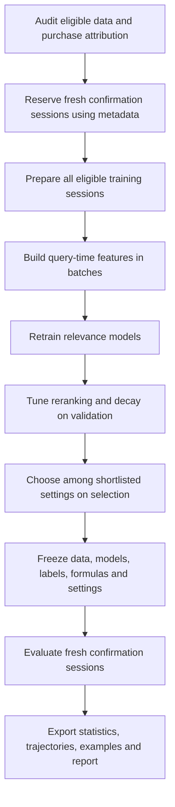

# CP4285 training and evaluation plan

Updated 7 November 2026. This is the working reference for continuing implementation
and writing the final report. Update the status and experiment records as work proceeds.

The research question is whether the diversity of earlier interactions in an
anonymous shopping session can guide the relevance and diversity balance of its
recommendations. The next experiment expands the pilot training data and compares
threshold, linear, and exponential adaptive policies.

## Research hypothesis

Several similar running shoes suggest focused interest and a larger relevance
weight. Products across categories suggest broader interest and a larger diversity
weight. If browsing starts broadly and then concentrates on running shoes, recent
interactions may provide a stronger signal of current intent.

The weight responds to observed session behaviour. Interaction count alone does
not establish a preference for more variety. Every prediction uses the history
available before that query in the same anonymous daily session.

## Completed pilot and expanded implementation

| Component | Current status |
|---|---|
| Anonymous preprocessing | Implemented with original ranks, click labels, event logs and strict query-time histories |
| Purchase records | Saved in events and eligible earlier histories |
| Relevance training | Two LightGBM LambdaRank models with click labels, with and without session features |
| Relevance recency | Time since a candidate's last earlier interaction is a feature |
| Session variety | Equal-weight ILD over distinct earlier clicked/viewed products |
| Reranking | Relevance-only, quota, fixed-weight and threshold-adaptive policies |
| Explicit history time decay | Implemented: linear windows and exponential half-lives; expanded experiment not run |
| Linear and exponential adaptive weight functions | Implemented with shared endpoints and sparse-history fallback; expanded experiment not run |
| Purchase-aware training and evaluation | Implemented with last-touch audit, graded gains, gain sensitivity and separate purchase metrics; expanded training not run |
| Expanded training | Implemented for all eligible queries; not executed at the user’s request |
| Pilot report | Completed with a 2,000-query training sample |

The pilot used 2,000 training queries, of which 1,993 had a clicked candidate for
ranking training. Validation contained 503 queries, selection 1,000, and confirmation
1,000. Complete sessions explain why a requested query target may be exceeded.

The existing study is recorded under
`results/anonymous_study/20261105T044003Z-6e85be4a/`. Its report and frozen choices
describe the click-based threshold experiment. Keep that record reproducible.

The raw metadata audit on 7 November found 923,127 query rows in total. Within
the current 1 April through 29 April training window, 145,039 queries in 93,231
daily sessions satisfy the existing hidden-label exclusion rule. These are counts
before excluding queries with no positive ranking label.

## Expansion flow



The pilot supplies tested code and a comparison baseline. Train the expanded
models from scratch on all eligible training sessions, including the pilot
sessions. The user will run the learning curve manually, one size at a time.

## Manual training and tuning controls

See [TRAINING_CONFIG_GUIDE.md](TRAINING_CONFIG_GUIDE.md) for the runnable commands,
full configuration, formulas, setting definitions, and log interpretation.

The requested manual progression is 2,000 → 10,000 → 50,000 → all eligible queries.
Use `uv run main.py train --queries 2000`, then change only the size when ready.
`uv run main.py compare` reads completed sizes without training. Each command
stops after validation and leaves selection and confirmation unopened.

`--queries` is required and controls the size. The editable JSON has no size
default. `config/learning_curve.json` controls the output directory, fixed
comparison metric, seeds, threads, label gains, and the `training` hyperparameters.
The tree-size and minimum-leaf-size lists define a Cartesian tuning grid. Scalars
control learning rate, maximum rounds, stopping patience, logging, depth, bins,
regularization, feature/row sampling, and ranking truncation. Every attempted
trial is saved as CSV and JSON with its validation scores and duration.

Use the same config at every size. The samples use prefixes of one deterministic
session order, preserving whole sessions and nesting the query sets. Popularity
features use only each size's training sessions; validation identities and labels
remain fixed. Models are retrained from scratch, and repeating a command resumes
that size rather than starting the next one. The default primary comparison
endpoint is click NDCG at every size, with purchase-aware NDCG and purchase recall
reported alongside it. Use single-value grids for a fixed-hyperparameter curve.

For a new learning rate or tuning grid, copy the JSON and choose a different
`output_directory` (or `--curve-root`). Incompatible settings cannot overwrite an
existing curve. See the README for commands, setting definitions, and output files.
Ranking controls are now explicit in the manual config: `top_k`; relevance
`decay_function_type` and dimensionless `decay_function_rate`; alpha bounds and
fixed/fallback weights; history decay type and rate per minute; history cap,
minimum usable history items, and the diversity measure. The manual run compares
its configured reranker with relevance-only on validation for every model. Both
sets of metrics are saved and plotted. Decay does not change the LambdaRank loss.
K controls metric cutoffs, stopping measurements, and recommendation list length.
The shared history cap also affects query-time relevance features.

No real-data training is launched as part of this code update.

## Data preparation and purchase attribution

Keep the existing chronological windows and session boundaries. Use fresh output
folders for expanded tables and preserve source fingerprints, sample seeds and
complete-session checks. Reuse the existing validation and selection queries for
development comparisons across training sizes.

Reserve a fresh confirmation sample from eligible later sessions, excluding every
session in the previously inspected confirmation set. Save its IDs and sampling
rule before inspecting its outcomes. Record its chosen size in the new protocol.

Audit purchases before deciding their role in the expanded model. Report purchase
events, distinct purchased products, purchase-bearing sessions, and candidate-list
matching coverage for each split. The pilot's 113 purchase events cover training,
validation and selection together.

Purchases identify a session, item and time. An attribution candidate is the most
recent preceding query in that session whose candidate list contained the item.
This is a last-touch heuristic. Record ambiguous repeated-query cases and unmatched
purchases, and examine sensitivity to attribution choices. Finalize the rule before
creating purchase labels or tuning models.

A later purchase may supply an outcome label for an earlier query. An earlier
purchase may supply context for a later query. All feature timestamps must remain
strictly earlier than the query. Keep equal-time ordering unknown.

## Feature construction and relevance training

Build candidate rows in batches to control memory use. A query can have 200
candidates, so 100,000 queries can create up to 20 million rows. Preserve the
query grouping required by LambdaRank.

Recompute popularity features using earlier training days for each training query.
Freeze end-of-training aggregate statistics for validation, selection and
confirmation. Keep the existing history cap visible in the audit, including the
number of queries whose histories were truncated.

Retrain the models with and without same-session features using the same data and
tuning budget. Retain the existing click-only model as a baseline. Compare their
scores on the fixed validation queries with the pilot results.

The existing tree search starts with 15 or 31 leaves, 100 or 300 minimum rows per
leaf, learning rate 0.05, at most 500 trees, and early stopping after 30 rounds
without validation improvement. Record any changes to this grid before selection.

Purchase-aware training is a proposed additional experiment. If attribution
coverage and purchase counts support it, use integer grades 0, 1 and 2 with explicit
gains 0, 1 and 3 for no recorded positive outcome, click, and attributed purchase.
An item receives its highest applicable outcome gain once.

The purchase gain of 3 is a starting utility choice. Record sensitivity checks
for other gains, using a common declared evaluation gain scheme when comparing
models. Keep click and purchase metrics separate alongside the combined metric.
If purchase evidence is insufficient, retain click relevance as the primary
endpoint and report purchase results as exploratory.

## Session diversity and history time decay

Keep candidate distance defined as an equal blend of category mismatch and
product-name Jaccard distance. Report the two components separately.

Use distinct earlier interacted products for session variety, consistent with the
pilot. For a recency-weighted variant, retain each product's latest eligible
interaction time. Repeated clicks/views can remain separate frequency features.
Audit history metadata coverage.

For historical item i, let age_i be its age in minutes at the current query.

- No time decay gives w_i = 1.
- Linear time decay gives w_i = max(0, 1 - age_i / W), with W > 0.
- Exponential time decay gives w_i = exp(-lambda * age_i), with lambda > 0.
  A half-life h minutes corresponds to lambda = ln(2) / h.

Compute weighted session diversity from known pairs of distinct products.

```text
H_t = sum over i<j of [w_i * w_j * distance(i,j)]
      / sum over i<j of [w_i * w_j]
```

Only pairs with known distance contribute to either sum. If the denominator is
zero, use the sparse-history fallback. Linear decay can produce this case when
all historical products lie outside its window.

Time decay changes how earlier behaviour contributes to H_t. The adaptive
function below changes how H_t controls the recommendation balance. Test these
effects separately before combining them.

## Adaptive relevance and diversity weights

For a candidate i and already selected list L, use the existing greedy objective.

```text
score(i, t, L) = alpha_t * normalized_relevance(i)
                + (1 - alpha_t) * mean_distance(i, L)
```

Relevance is min-max normalized within each query. The first selected item has the
highest relevance score. Ties preserve the original candidate order.

Compare the existing hard-threshold policy with continuous alternatives. Let
0 <= alpha_min <= alpha_max <= 1 and 0 <= H_t <= 1.

```text
Linear
alpha_t = alpha_min + (alpha_max - alpha_min) * (1 - H_t)

Exponential candidate discussed in the design
alpha_t = alpha_min + (alpha_max - alpha_min) * exp(-beta * H_t)
```

The exponential candidate has a positive residual above alpha_min at H_t = 1.
For a comparison with matched endpoints, the proposed normalized variant is

```text
alpha_t = alpha_min + (alpha_max - alpha_min)
          * [exp(-beta * H_t) - exp(-beta)] / [1 - exp(-beta)]
```

Use beta > 0. Its limit as beta approaches zero is the linear mapping.
Finalize the implemented form and numerical handling before tuning. Keep the
endpoint distinction explicit in the report.

For illustration, alpha_min = 0.3 and alpha_max = 0.9 give linear relevance
weights 0.84, 0.60 and 0.42 for H_t values 0.1, 0.5 and 0.8 respectively.
These are explanatory values rather than frozen experiment settings.

Tune a shared sparse-history default on validation. Require at least two distinct
products with measurable pair distances before using an adaptive H_t.

## Comparisons and tuning order

Use the same candidate lists and relevance model within each reranking comparison.

1. Compare relevance-only, the original relevance quota, fixed weight, and the
   existing threshold-adaptive policy.
2. Compare threshold, linear and exponential adaptation using equal-weight history.
3. Compare history time decay with no decay while holding the adaptive form fixed.
4. Evaluate any shortlisted combination after its individual components have been
   assessed. Save every attempted setting, including unsuccessful settings.

Declare a small parameter grid and the primary relevance metric after the purchase
audit, before evaluating selection outcomes. Tune relevance models and reranking
parameters on validation. Nominate one setting per policy family for selection.

Retain the initial rule of maximizing combined ILD while allowing at most a 5%
relative drop in the declared primary NDCG metric and no ILD loss against the
relevance-only baseline. A baseline of 0.40 therefore requires at least 0.38.
Record any change to this allowance before selection. Keep the simpler policy
when measured quality ties.

The selection set chooses among the validation-nominated settings. Freeze the
winner and the comparison settings before opening the fresh confirmation outcomes.

## Evaluation calculations

| Measurement | Calculation and population |
|---|---|
| Purchase-aware NDCG@10 | Sum gain/log2(rank+1), divided by the ideal score within the query candidates, using a common declared gain scheme |
| Click NDCG@10 | The same calculation with binary observed-click gains |
| Click Recall@10 | Clicked candidate products retrieved in top 10 divided by all clicked candidate products |
| Purchase Recall@10 | Attributed purchased candidates retrieved in top 10 divided by all attributed purchased candidates |
| ILD@10 | Mean known pair distance in the top 10, with token, category and blended results and coverage |
| Runtime | Feature construction, model scoring, distance construction and reranking measured with clearly stated boundaries |

Average per-query measurements with equal query weight. Exclude a query from a
relevance metric when its ideal gain or relevant-item denominator is zero, and
report that denominator. Purchase recall covers purchase-bearing eligible queries.
Diversity covers lists with at least two products and known comparisons.

Report purchases outside candidate lists separately so conditional purchase recall
does not hide retrieval coverage. Logged nonclicks and missing purchase records
describe observed data availability.

Use 2,000 bootstrap resamples of whole daily sessions for paired policy comparisons.
Keep all queries belonging to a sampled session together and retain a query-weighted
mean. Report 95% intervals and the number of contributing queries and sessions.

NDCG is a ranking score. Claims about increased actual CTR or purchase conversion
require online evaluation. Historical click and purchase metrics support offline
ranking comparisons.

## Evidence required in the final report

The final report should explain the research question, hypotheses, data boundaries,
label attribution, model training, policy formulas, selection rule and final results.

Include the following evidence.

- Pilot versus expanded model results on the same validation queries.
- Dataset and purchase-attribution counts for each split, including exclusions.
- Actual formulas, parameter grids, selected values, seeds and input/model/code hashes.
- A relevance-diversity trade-off plot for the tested settings.
- Within-session trajectories showing H_t, alpha_t and interaction count over time.
- Focused-shoe, broad-interest, broad-to-focused and sparse-history examples.
- Separate click, purchase and diversity metrics with session-level uncertainty.
- Threshold versus linear versus exponential comparisons and separate time-decay ablations.
- Runtime and memory observations for the expanded feature pipeline.
- Recommendation examples showing both improvements and failures.
- Discussion of position-biased feedback, purchase-attribution assumptions,
  sparse purchases, lexical diversity, session boundaries and the history cap.

Keep implementation status, exploratory choices and frozen final results clearly
identified. The completed pilot supports conclusions about its click-based
threshold policy. The expanded experiment supplies evidence for the additional
purchase and decay hypotheses.

## Implementation status

Implemented in the `main.py` expanded entry point. Start with `uv run main.py
expand`; continue a printed run folder with `uv run main.py expand-resume
--study-run results/expanded_study/<run-folder>`. The configuration is
`config/expanded_study.json`. Completed stages are hash-checked before reuse.

The new modules are `expanded_data.py` (reservation, SQLite, attribution and
batched features), `expanded_training.py` (click/purchase LambdaRank and gain
sensitivity), `adaptive_policies.py` (continuous weights, time decay and metrics),
`expanded_experiment.py` (tuning, selection, freeze and confirmation), and
`expanded_report.py` (white standalone HTML, intervals, charts and examples).
Each module is under `src/session_rerank/` and has explanatory comments.

Execution status: code and tests are complete. A preliminary development-data
preparation attempt was stopped before model training. It exposed a slow
split/session lookup on the Windows drive; a covering index and bounded SQLite
cache have been added. No expanded model training, selection, fresh confirmation
outcomes or final expanded report have been produced. Do not start the expanded
experiment until the user asks to run it.

The finite grid uses 15/31 leaves and minimum leaf sizes 100/300, learning rate
0.05, up to 500 trees, and 30-round validation early stopping. Purchase gain
sensitivity fits keep the nominal purchase/session model's best leaf settings.
History time decay uses 5/30-minute linear windows or exponential half-lives.
Continuous alpha bounds are [0.2,1] or [0.4,1]; normalized exponential beta is
1 or 3. Baseline-equivalent settings are also included. Sparse history uses the
validation-selected fixed weight. Every setting and its score is saved.

Before scores are examined, purchase-aware NDCG is primary only if the audit
finds at least 100 purchase-bearing training queries and 20 validation queries.
Otherwise click NDCG is primary, with purchase outcomes additional. Both click
and purchase-aware model variants are retained. Sensitivity models are diagnostic
and cannot silently replace the nominal selected scorer.

Verification covers synthetic end-to-end fitting, frozen confirmation,
source/checkpoint verification, strict event cutoffs, attribution ambiguity,
continuous endpoints, history decay and graded metric calculations. Actual
full-data outcomes and execution observations belong to each new run's report;
implementation and test completion alone do not establish the hypotheses.

The added `ranking_settings.py` validates the controls and documents their units.
`configured_reranking.py` evaluates the manual policy without opening final-test
outcomes. The full expanded study also uses configured K consistently in its
metrics, lists and report labels; its decay search grid remains in the expanded
study config.

## Existing code entry points

| File | Role |
|---|---|
| `main.py` | Visible high-level stage calls |
| `config/anonymous_samples.json` | Existing pilot sampling protocol |
| `src/session_rerank/samples.py` | Anonymous sampling and chronological histories |
| `src/session_rerank/ranker_features.py` | Query-time features and training-only popularity |
| `src/session_rerank/train_rankers.py` | Current click-labelled LightGBM training |
| `src/session_rerank/diversity.py` | Product distances and ILD definitions |
| `src/session_rerank/reranking.py` | Current list builders and threshold adaptation |
| `src/session_rerank/anonymous_study.py` | Validation, selection and frozen confirmation |
| `src/session_rerank/study_report.py` | Statistics, figures and report generation |

## Method references

The session-diversity hypothesis is motivated by Gharahighehi and Vens,
Personalizing Diversity Versus Accuracy in Session-Based Recommender Systems.
The proposed shopping experiment extends the existing pilot with additional
weighting functions and purchase signals.
[Paper](https://doi.org/10.1007/s42979-020-00399-2)

LightGBM supports integer relevance labels and explicit gain mappings.
[Parameter documentation](https://lightgbm.readthedocs.io/en/stable/Parameters.html#label_gain)
